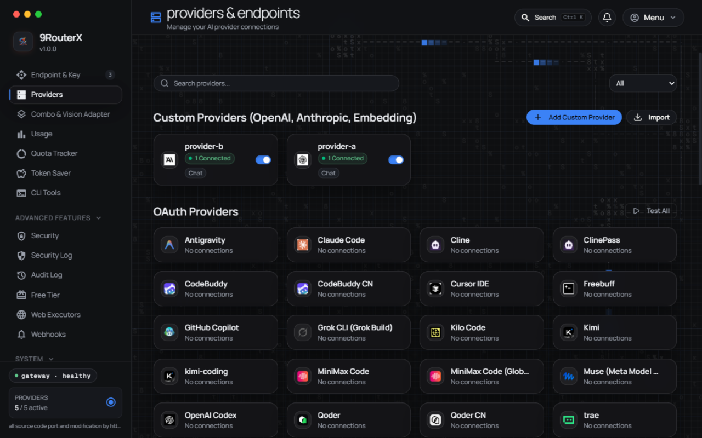
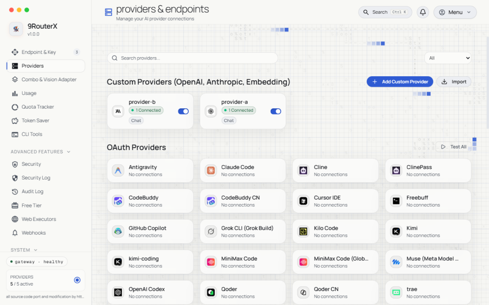
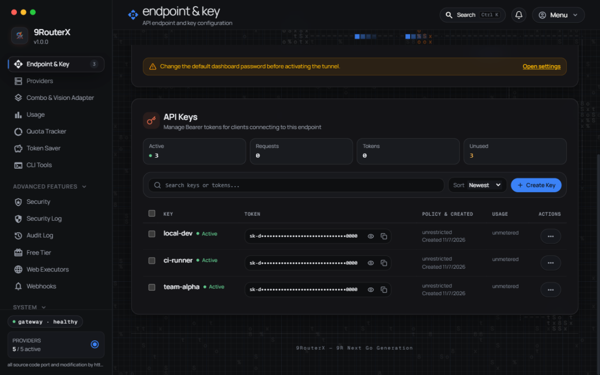
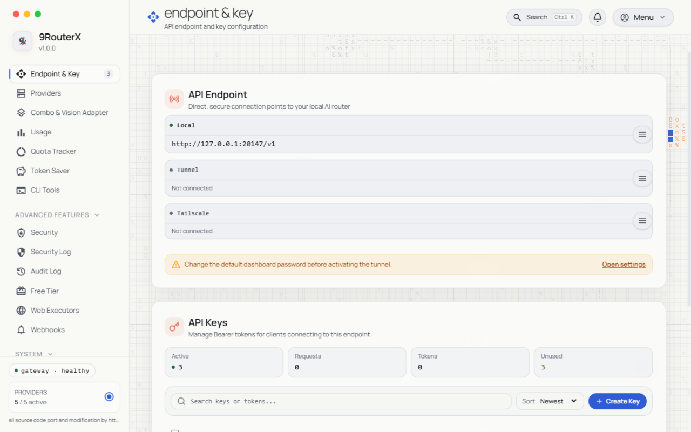
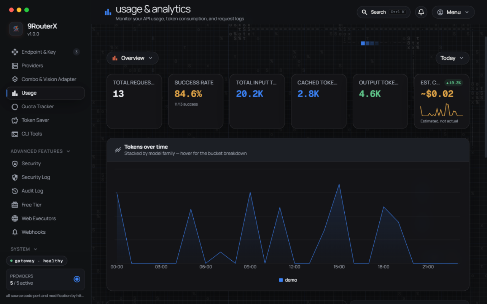
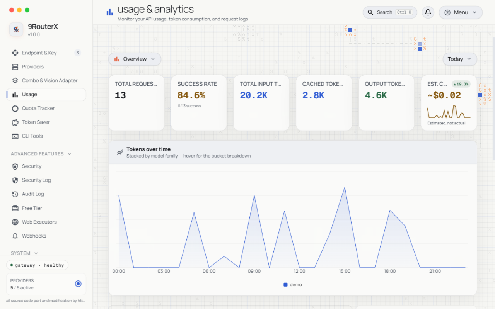
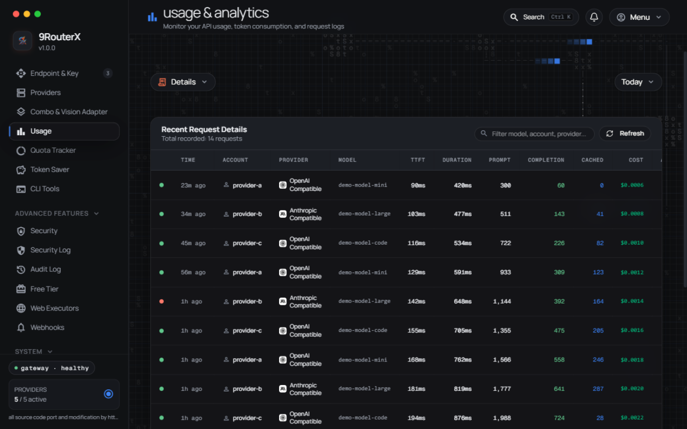
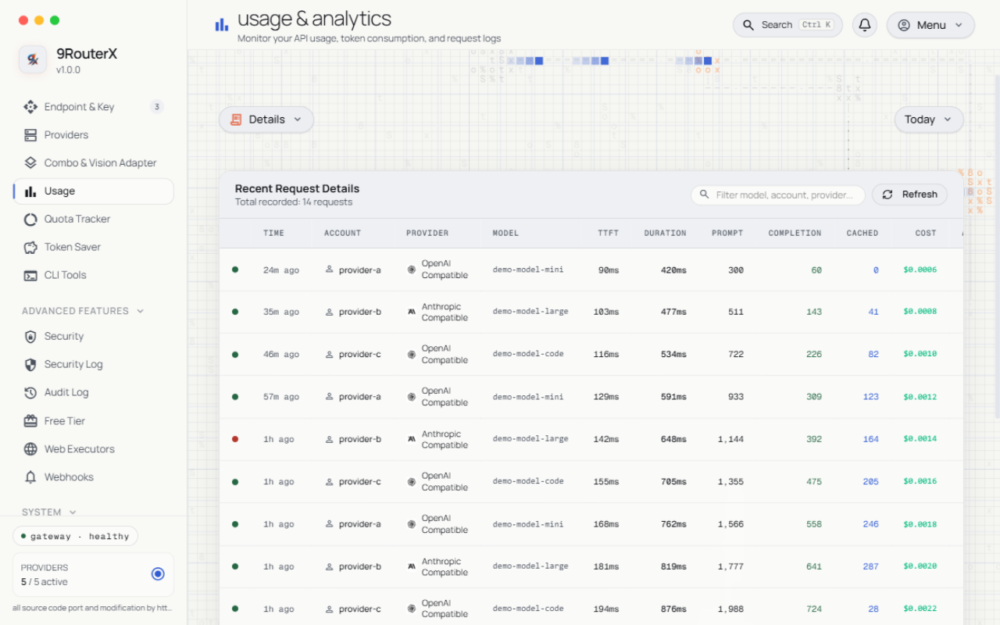

<div align="center">

# 9RouterX — FREE AI Router & Token Saver (Single Binary)

**A local AI gateway and LLM router in one Go binary: connect Claude Code, Codex, Cursor, Antigravity, Gemini, OpenCode, Cline, OpenClaw... to 40+ AI providers & 100+ models — with automatic fallback across subscription, cheap and free tiers, per-key governance, and a token-saver suite that cuts tool-output tokens by 20-40%. No Node.js needed at runtime.**

**Never stop coding. Route smarter, spend less.**

[](https://github.com/yanstd888/9routerx/actions/workflows/ci.yml)
[](https://github.com/yanstd888/9routerx/actions/workflows/release.yml)
[](https://github.com/yanstd888/9routerx/releases/latest)
[](https://github.com/yanstd888/9routerx/blob/main/LICENSE)
[](https://github.com/yanstd888/9routerx/releases)
[](https://yanstd888.github.io/9routerx/tg)
[](https://github.com/yanstd888/9routerx)

[🚀 Quick Start](#-quick-start) • [💡 Features](#-key-features) • [⚙️ Setup](#-setup-guide) • [🔄 Share DB with 9Router](#-sharing-a-database-with-9router) • [📖 Wiki](https://yanstd888.github.io/9routerx/) • [🌐 Upstream](https://github.com/decolua/9router)

</div>

---

## 🤔 Why 9RouterX?

Same idea as [9Router](https://github.com/decolua/9router), minus the Node.js runtime: **one Go binary** serves the proxy APIs + an embedded Svelte 5 dashboard.

**Stop wasting money, tokens and hitting limits:**

- ❌ Subscription quota expires unused every month
- ❌ Rate limits stop you mid-coding
- ❌ Tool outputs (git diff, grep, ls...) burn tokens fast
- ❌ Manual switching between providers

**9RouterX solves this:**

- ✅ **RTK Token Saver** — auto-compress tool_result content, save 20-40% tokens
- ✅ **Auto fallback** — Subscription → Cheap → Free, zero downtime
- ✅ **Extended combo routing** — per-combo strategy: fallback, round-robin, sticky, capacity, or fusion
- ✅ **Multi-account** — round-robin between accounts per provider
- ✅ **Proxy per API key** — bind a proxy pool to each provider API key (connection), one-by-one or via **Apply Proxy** across many at once
- ✅ **Custom headers** — add your own request headers to custom compatible providers
- ✅ **Unified custom provider add** — one shared dialog adds OpenAI-/Anthropic-compatible endpoints
- ✅ **Custom usage ranges** — analyze any window (`14d`, `12h`), not just fixed presets
- ✅ **Extended logging** — live console log with level filters & search, plus per-request payload inspector
- ✅ **Single binary** — Go + embedded dashboard, works with Claude Code, Codex, Cursor, Cline, any CLI tool

---

## 🧭 What's different from 9Router / 9router-go?

9RouterX is a fork of [9router-go](https://github.com/luqman-v1/9router-go) (luqman-v1), which is itself a Go port of [9Router](https://github.com/decolua/9router) — full credit and attribution live in [Acknowledgments](#-acknowledgments) and [ATTRIBUTION.md](ATTRIBUTION.md). On top of that lineage, 9RouterX adds:

- **Single Go binary, zero runtime deps** — proxy APIs + Svelte 5 dashboard embedded in one executable; no Node.js process to keep alive.
- **Per-key governance** — daily cost ceilings with hard cutoff, request limits, IP whitelists, per-key system prompts, endpoint permissions, and reusable plan templates you can stamp onto many keys.
- **The full token-saver suite** — beyond RTK compression: anti-slop injector, context squeezer, tool-call repair fallback, JSON guard, per-tool output filters, and the Caveman & Ponytail output styles.
- **New routing strategies** — cache-optimized, auto, quota-weighted, and reset-aware combo routing, plus a 3-tier circuit breaker across subscription, cheap, and free tiers.
- **Semantic cache + prompt cache** — repeated identical requests are served from cache, cutting cost and latency for multi-agent loops and CLI repetition.
- **MCP server + A2A endpoints** — wire agentic tooling (IDE assistants, agent-to-agent clients) straight into the gateway.
- **Security log + hardening** — per-event security log with alerting, SSRF guard with PII masking, TLS stealth, and audit log v2.
- **Indonesian & English dashboard** — built for the [t.me/aiclub_id](https://t.me/aiclub_id) community first, with a desktop tray companion and a one-command Cloudflare tunnel for remote access.

---

## 🔄 How It Works

```text
┌─────────────┐
│  Your CLI   │  (Claude Code, Codex, OpenClaw, Cursor, Cline...)
│   Tool      │
└──────┬──────┘
       │ http://localhost:888/v1
       ↓
┌─────────────────────────────────────────────┐
│         9routerx (Smart Router)            │
│  • RTK Token Saver (cut tool_result tokens) │
│  • Format translation (OpenAI ↔ Claude)     │
│  • Quota tracking                           │
│  • Auto token refresh                       │
└──────┬──────────────────────────────────────┘
       │
       ├─→ [Tier 1: SUBSCRIPTION] Claude Code, Codex, GitHub Copilot
       │   ↓ quota exhausted
       ├─→ [Tier 2: CHEAP] GLM ($0.6/1M), MiniMax ($0.2/1M)
       │   ↓ budget limit
       └─→ [Tier 3: FREE] Kiro, OpenCode Free, Vertex ($300 credits)

Result: Never stop coding, minimal cost + 20-40% token savings via RTK
```

---

## ⚡ Quick Start

**1. Install (one line):**

```bash
# macOS / Linux
curl -fsSL https://raw.githubusercontent.com/yanstd888/9routerx/main/install.sh | bash
```

```powershell
# Windows (PowerShell — installer writes to %LOCALAPPDATA% + user PATH, no admin needed)
irm https://raw.githubusercontent.com/yanstd888/9routerx/main/install.ps1 | iex
```

🎉 Then start it (defaults: port `888`, data `~/.9router` — no flags needed):

```bash
9routerx
# Dashboard: http://localhost:888 (Default password: 123456)
```
> **Already using upstream [9Router](https://github.com/decolua/9router)?** Point 9routerx at the same data dir — it opens the **same `DATA_DIR/db/data.sqlite`**. Your providers, connections, combos, API keys, and usage history carry over as-is. No import step, no migration. See [Sharing a database with 9Router](#-sharing-a-database-with-9router) for the caveats.

**Keep the terminal free (background mode):**

```bash
9routerx start          # same as: 9routerx --background   (or -d)
9routerx status         # is it running? (pid, dashboard, log)
9routerx restart        # replace the running daemon
9routerx logs -n 100    # tail the background log
9routerx stop           # stop it
```

The detached process records itself in `DATA_DIR/run/gateway.pid` and writes its
output to `DATA_DIR/run/gateway.log`. A second `start` while one is running
refuses instead of fighting over the port, and a daemon killed from Task Manager
leaves nothing behind: the stale pid file is cleaned on the next command.
> Windows stops the process with `TerminateProcess` instead of `SIGTERM`, so
> stopping skips the graceful drain; use the dashboard's Shutdown button or
> `9routerx restart` when you want in-flight streams to finish first.

**Start on boot (autostart):**

```bash
9routerx service install     # systemd user unit, launchd agent, OpenRC/runit service, cron @reboot, or a Windows logon task
9routerx service status      # which backend owns the entry, and whether it is enabled/active
9routerx service start       # start the supervised service now (falls back to the background daemon)
9routerx service restart     # restart it
9routerx service stop        # stop it now but keep it enabled for boot
9routerx service uninstall   # remove the autostart entry
```

`install` picks the native backend for the host. systemd, launchd, and cron all
install into the **user** scope and need no root; runit's `~/service` path too.
Two exceptions: OpenRC is a system service and needs root (`service install`
refuses without it — run with `sudo`, or pick `--backend cron`), and on Windows
install registers a scheduled task via `schtasks`, which requires an
Administrator console. The Windows task runs as the current user at logon, so it
reads that user's data dir rather than `SYSTEM`'s. Force a backend with
`--backend systemd|launchd|openrc|runit|cron`.

**2. Connect a FREE provider (no signup needed):**

Dashboard → Providers → Connect **Kiro AI** (~50 credits/month free) or **OpenCode Free** (no auth) → Done!

**3. Use in your CLI tool:**

```text
Claude Code / Codex / OpenClaw / Cursor / Cline Settings:
  Endpoint: http://localhost:888/v1
  API Key:  [Settings → API Keys in the dashboard]
  Model:    kr/claude-sonnet-4.5
```

**That's it!** Start coding with FREE AI models.

**Alternatives:**

```bash
# Docker — no build needed
docker run -d --name 9routerx --restart unless-stopped \
  -p 888:888 -v "$HOME/.9router:/data" \
  -e PORT=888 -e DATA_DIR=/data \
  -e INITIAL_PASSWORD=your-secure-password \
  ghcr.io/yanstd888/9routerx:latest

# Manual download — pick your file, no command line guesswork:
# Windows → .exe | Mac M1+ → darwin-arm64 | Mac Intel → darwin-amd64
# Linux VPS → linux-amd64 | Raspberry Pi → linux-arm64
```

📦 [All release binaries](https://github.com/yanstd888/9routerx/releases/latest) • 🔨 [Build from source](#-setup-guide)

---

## 💡 Key Features

**Cost & token savings**

- 🗜️ **RTK input compression** — auto-compress `tool_result` content (git diffs, grep output, file listings) before it reaches the model; 20-40% fewer tokens on agentic workloads.
- 🧹 **Anti-slop injector** — strips the filler phrases and sycophantic patterns that inflate every response.
- ✂️ **Context squeezer** — older conversation turns are elided with an honest marker to fit a model's context window, keeping the most recent turns verbatim.
- 🔧 **Tool-call repair fallback** — malformed tool arguments are repaired, truncated JSON is closed, and orphaned tool results are dropped before they become an upstream 400.
- 🛡️ **JSON guard** — non-finite numbers and JSON-shaped hazards are sanitized on every lane.
- 🪠 **Per-tool output filters** — 50+ ready-made filters for `git diff`, `grep`, `docker logs`, `npm install`, `terraform plan`, and friends, so one noisy tool doesn't tax every turn.
- 🗿 **Output styles** — Caveman and Ponytail directive modes re-shape compressed output for even heavier savings.
- 🧠 **Semantic cache + prompt cache** — identical requests are served from cache instead of the provider: repeated multi-agent probes and CLI re-runs stop paying twice. Semantic hits are attributed in usage analytics; the prompt cache is a bounded LRU keyed on the exact prompt.
- 📦 **GCF compression** — dashboard assets ship pre-compressed (`.br`/`.gz`) for a fast first paint.

**Governance & security**

- 🎛️ **Per-key governance** — daily cost ceiling (USD per UTC day) with optional hard cutoff, request limits with reset windows, RPM/TPM/concurrency caps, and alert thresholds — enforced per API key, not per server.
- 🧾 **Plan templates** — bundle limits into a reusable plan and stamp it across many keys; key-level overrides win.
- 🔒 **IP whitelist per key** — a key only works from the addresses (IP/CIDR list) you allow.
- 🧩 **Per-key system prompt & endpoint permissions** — inject a system prompt per key in the client's wire format, and restrict which endpoint families (chat, embeddings, images, ...) a key may call.
- 🚨 **Security event log** — per-event security log with alerting on suspicious patterns, plus a compliance-grade audit log v2.
- 🧱 **SSRF guard + PII masking** — outbound dialing and inbound payloads are guarded; private-network escapes are opt-in flags.
- ⚡ **3-tier circuit breaker** — per-provider breaker + per-account semaphore across the subscription → cheap → free chain: dead accounts stop receiving traffic on evidence, not on hope.
- 🕵️ **TLS stealth** — hardened TLS fingerprint handling for providers that grade their clients.

**Integrations**

- 🤖 **MCP server** — Model Context Protocol over stdio (IDE integrations) and HTTP POST (remote callers), with a scoped auth token: browse providers, read usage, and run operator actions from your agent.
- 🔗 **A2A endpoints** — Agent-to-Agent protocol surface (agent card + `message/send`, `tasks/*`) so other agents can consume the gateway directly.
- 📲 **Telegram notifications + multi-target webhooks** — push gateway events to Telegram and to any operator-configured webhook fleet.
- 🔔 **Notification feed** — condition scanners watch system and key health and write a dashboard feed, with fan-out to the webhook targets.
- 👥 **Teams billing** — multi-seat team plans with shared budgets.
- 💾 **Config bundle import/export** — move a whole configuration between installs as an encrypted bundle (AES-256-GCM under `ROUTER_MASTER_KEY`).
- 🖥️ **Tray companion** — `9routerx-tray` puts start/stop/status in the menu bar on Windows, macOS, and Linux.
- 🌍 **Cloudflare tunnel** — one command exposes the dashboard through a named cloudflared tunnel, no port-forwarding dance.
- 🌐 **Web executors** — optional browser-session executors (ChatGPT web, Gemini web with background session renewal) for accounts that only exist in a browser.
- 🇮🇩 **Indonesian & English dashboard** — full i18n for both languages (Bahasa Indonesia dan Inggris), switchable in settings.

**Ops & reliability**

- 📊 **Usage analytics** — live SSE usage + console-log streams, cost display in USD/IDR/EUR and ten more currencies (editable rate table), custom analysis windows, and cache-hit attribution.
- 🩺 **Model health + scheduled auto-ping** — models you actually use are probed automatically, consecutive failures are counted, and dead models drop out of routing; scheduled pings keep idle connections warm.
- 📶 **Uptime heartbeat** — push a heartbeat to Uptime Kuma (or any Push-Monitor-compatible endpoint) so you learn about downtime from your monitor, not from a CLI tool that stopped answering.
- 🔢 **Codex quota tracking** — watch Codex quota consumption and reset-credit windows from the dashboard.
- 💽 **Backup/restore** — database backups and restores are dashboard features, not shell rituals.
- ⌨️ **Command palette + bulk operations** — every dashboard action reachable from a palette; bulk-add providers, keys, and models instead of clicking through one-by-one.
- 🆓 **Free-tier catalog + custom credits** — browse a built-in free-tier provider catalog and track custom credit balances per account.
- 🔁 **Routing strategies** — per-combo fallback, round-robin, sticky, capacity, fusion, plus cache-optimized, auto, quota-weighted, and reset-aware strategies.
- ⏱️ **Per-combo response timeout & grace period** — a model that hangs is skipped and briefly benched; see the [wiki's combos page](https://yanstd888.github.io/9routerx/combos.html) for the details.
- 💿 **SQLite WAL persistence** — single-file storage with WAL concurrency, outbound proxy support, self-update, MITM commands, Docker, and cross-compilation.

---

## 🔄 Sharing a database with 9Router

**Already running [9Router](https://github.com/decolua/9router) (the Next.js version)? 9routerx reads that exact database. There is no import, no export, and no migration step.**

Both projects default to the same file and speak the same schema:

| | Path |
|---|---|
| macOS / Linux | `~/.9router/db/data.sqlite` |
| Windows | `%APPDATA%\9router\db\data.sqlite` |
| Docker | `/data/db/data.sqlite` inside the container |

Stop 9Router, start 9routerx, and log in with your existing password. Your provider connections, proxy pools, combos, API keys, model aliases, and usage history are all there — 9routerx's own dashboard renders them, because it *is* the same data.

**You don't even have to stop 9Router** if you want to keep the Node.js dashboard around. Run 9routerx on a different port against the same `DATA_DIR`:

```bash
# 9Router on :20128 (Next.js)  ·  9routerx on :888 (Go, same DB)
PORT=888 DATA_DIR=/home/you/.9router ./9routerx
```

Both read the same tables, so a connection you add in either dashboard shows up in the other. SQLite serialises the writes; the supported setup is one active writer, so avoid editing the same combo or settings entry in both at the same moment.

**Running it the other way round** (9routerx first, then pointing 9Router at the same directory) works the same way. 9routerx will have added two columns to `providerConnections` (`lastUsedAt`, `consecutiveUseCount`) and one extra table (`upstream_leases`). Upstream ignores both — its schema sync is additive and doesn't drop unknown columns — so nothing breaks.

What 9routerx will **not** do:

- **Import a legacy JSON export.** If your 9Router data still lives in old JSON files, start upstream once to convert them, then switch.
- **Run destructive migrations or pre-migration backups.** Its bootstrap only ever *adds* — create missing tables, add missing columns, seed missing rows. It never drops or retypes.
- **Interpret `_meta.schemaVersion`.** It's upstream's migration bookkeeping. A database written by a much newer 9Router release should be checked before you rely on it.

Take a backup first if the database matters:

```bash
cp -r ~/.9router/db ~/9router-db-backup   # stop the daemon first — see DATABASE.md
```

Full schema, operator contract, and multi-process limits: [`DATABASE.md`](DATABASE.md). Routing internals: [`ARCHITECTURE.md`](ARCHITECTURE.md).

---

## 📸 Screenshots

Every screen ships in dark and light themes, at desktop and mobile widths. The
full gallery — with per-page commentary — lives on the wiki's
[**Screenshots**](https://yanstd888.github.io/9routerx/screenshots.html) page.

| | Dark | Light |
|---|---|---|
| **Providers** — connect AI providers and manage custom OpenAI/Anthropic-compatible endpoints |  |  |
| **Endpoint & API keys** — the OpenAI-compatible endpoint your CLI tools point at, and the keys they authenticate with |  |  |
| **Usage overview** — live cost, tokens, and per-provider breakdown |  |  |
| **Request logs** — per-request payload inspector and live console |  |  |

Mobile layouts reflow the same pages behind a navigation sheet — see
[`docs/screenshots/`](docs/screenshots) for the full set, including
`*-mobile.png` (dark) and `*-mobile-light.png` (light) variants of every page.

---

## ⚙️ Setup Guide

### Release binary

Download from [GitHub Releases](https://github.com/yanstd888/9routerx/releases/latest), verify against `SHA256SUMS.txt`.

### 🧪 Experimental builds

Unreleased work also ships as **experimental** builds. They are published
separately and are never offered to a normal install:

- GitHub Releases marks them **Pre-release**, so `releases/latest` — the URL
  `9routerx update` falls back to — keeps pointing at the stable version.
- GHCR tags them `exp` (`ghcr.io/yanstd888/9routerx:exp`), never `latest`.

```bash
docker pull ghcr.io/yanstd888/9routerx:exp
```

Opt in only if you want to help shake out bugs. `9routerx update` will not
install one over a stable release — grab the asset for your platform from the
[pre-releases page](https://github.com/yanstd888/9routerx/releases) and
replace the running binary with it.

### Build from source

Prerequisites: Go 1.27 and Bun 1.x (dashboard is embedded into the binary, so build web first):

```bash
git clone https://github.com/yanstd888/9routerx.git
cd 9routerx
make web-build   # bun install --frozen-lockfile && bun run build
make build       # embeds VERSION into the Go binary
```

### Run

Defaults are enough for most people — plain `9routerx` listens on port `888` with data in `~/.9router`:

```bash
9routerx
curl http://localhost:888/health
./9routerx version
```

Only override when you need something different (`PORT`, `DATA_DIR`/`DB_PATH` — there are no `--port` flags):

```bash
PORT=20129 ./9routerx                        # different port
DATA_DIR=/srv/9router ./9routerx              # different data dir
DB_PATH=/srv/9router/data.sqlite ./9routerx   # explicit SQLite file
HOST=127.0.0.1 ./9routerx                     # localhost only, behind a reverse proxy
```

### 🔑 Dashboard Login & Fresh Install

- **Localhost (`localhost` / `127.0.0.1`)**: First login uses the default compatibility password `123456`. Once logged in, change your password in **Settings → Profile**.
- **Remote / VPS / Docker / LAN**: For security (preventing public takeover of fresh installs with known defaults, CVE-2026-56679), remote access blocks the default `123456` password. You **must** either:
  1. **Set `INITIAL_PASSWORD` on launch (Recommended)**:
     ```bash
     INITIAL_PASSWORD="your-secure-password" ./9routerx
     # Or in your .env file:
     # INITIAL_PASSWORD=your-secure-password
     ```
  2. **Or access via SSH port-forwarding first**:
     ```bash
     ssh -L 888:127.0.0.1:888 user@remote-host
     # Open http://localhost:888, login with 123456, then change password in Settings
     ```

### Client example

```bash
curl http://localhost:888/v1/chat/completions \
  -H 'Content-Type: application/json' \
  -H 'Authorization: Bearer sk-your-api-key' \
  -d '{"model":"ag/gemini-3.8-flash-high","messages":[{"role":"user","content":"Hello"}],"stream":true}'
```

For Claude Messages clients: `ANTHROPIC_BASE_URL=http://localhost:888/v1`.

<details>
<summary><b>Advanced: environment variables, API surface, auth, database</b></summary>

### Environment

| Variable | Default | Purpose |
| --- | --- | --- |
| `PORT` | `888` | HTTP port |
| `HOST` / `BIND_ADDR` | all interfaces | Listener address |
| `DATA_DIR` | `~/.9router` (`%APPDATA%/9router` on Windows) | Data root |
| `DB_PATH` | `$DATA_DIR/db/data.sqlite` | SQLite file |
| `INITIAL_PASSWORD` | unset (fallback `123456` locally) | First dashboard password |
| `RTK_ENABLED` | `true` | RTK input compression |
| `CAVEMAN_ENABLED` / `PONYTAIL_ENABLED` | `false` | Style savers |
| `AUTO_UPDATE` | `false` | Background self-update |
| `HTTP_PROXY` / `HTTPS_PROXY` | Go defaults | Upstream egress proxy |
| `PPROF_ENABLED` | `false` | Expose `/debug/pprof/*` (keep off on untrusted networks) |
| `TRUST_PROXY` / `TRUST_CLOUDFLARE` | unset | Trust forwarded client-IP headers |
| `TRUSTED_PROXIES` | unset | CIDR list of the reverse proxies whose forwarded client-IP headers are trusted |
| `GEMINI_WEB_ROTATION` | `on` | Renew the Gemini Web session cookie in the background (see below) |
| `LOG_LEVEL` | `info` | Log verbosity: `debug`, `info`, `warn`, `error` |
| `LOG_FORMAT` | `text` | Log encoding: `text` or `json` |
| `LOG_FILE` | stderr | Also mirror logs to this file (background daemon uses `DATA_DIR/run/gateway.log` regardless) |
| `AUTO_UPDATE_INTERVAL_HOURS` | built-in default | Hours between background self-update checks |
| `ENABLE_WEB_EXECUTORS` | `false` | Allow browser-session web executors (chatgpt-web, gemini-web, …). Keep off unless you need them |
| `ALLOW_PRIVATE_NETWORKING` | `false` | Let the gateway itself dial loopback/private addresses (SSRF guard release valve for exotic setups) |
| `ALLOW_PRIVATE_PROVIDER_URLS` | `false` | Permit provider endpoints pointing at loopback/private addresses |
| `NO_INSTALL_CA` | unset (`1` = skip) | Skip installing the local MITM CA (tests/CI) |
| `9ROUTERX_ROUTE_HEADERS` | `on` | Add `X-Route-*` response headers exposing which connection/model served the request (`0`/`false` turns them off) |
| `9ROUTERX_URL` | request origin | Gateway URL written into CLI tool config snippets (set when the dashboard is behind a proxy) |
| `9ROUTERX_STREAM_STALL_TIMEOUT_MS` | built-in default | Kill a stream that produces no bytes for this many milliseconds |
| `9ROUTERX_SEAT_ATTEMPT_BUDGET_MS` | built-in default | Per-seat retry budget, in ms, for transient upstream attempts in a combo |
| `9ROUTERX_SERVICE_BACKEND` | auto-detected | Force the `service install` backend: `systemd`, `launchd`, `openrc`, `runit`, `cron` |
| `9ROUTERX_PEER_TOKEN` | unset | When set, a front proxy presenting this token via `x-9r-peer-token` may stamp the real client IP (`x-9r-real-ip`) for login rate-limit bucketing |
| `ROUTERX_ENABLE_A2A` | `false` | Expose the Agent-to-Agent (A2A) endpoints |
| `ROUTERX_A2A_TOKEN` | unset (auth required when set) | Bearer token protecting the A2A endpoints |
| `ROUTERX_MCP_TOKEN` | unset (disabled) | Bearer token for the MCP server endpoint; empty disables it |
| `CLOUDFLARE_ACCOUNT_ID` | unset | Cloudflare account used by the Cloudflare image provider |
| `CHROME_PASS` | unset | Explicit Chrome profile password candidate for the cookie reader (Linux keyring fallback) |

Pre-rebrand spellings of the `9ROUTERX_*` / `NINEROUTER_*` variables are still
accepted for one release via a deprecation fallback that logs a warning naming
both spellings; rename them in your `.env` / service units when you see it.

#### Gemini Web session renewal

The `gemini-web` provider reaches `gemini.google.com` with a session cookie,
and Google rotates the session's timestamp cookie (`__Secure-1PSIDTS`) every
few minutes. The router renews it in the background, so a signed-in account
keeps reaching the models it pays for instead of falling back to one model
after a few minutes.

**There are three ways to get a session, and the dashboard offers two of
them as a button.**

1. *A throwaway browser* — the safest. The button opens a browser with a
   profile of its own, waits for the Google sign-in, reads the session out of
   it, then closes the browser and deletes the profile. Nothing is left
   running that could rotate the session, so the router's renewal is the
   only one.
2. *A browser that is already signed in* — the convenient one. The button
   opens the browser's own cookie database, takes the key that seals it from
   the platform's secret store (the login keyring on Linux, the Keychain on
   macOS, the profile's "Local State" file on Windows), and unseals the
   cookies. **A browser that is still open keeps rotating the same session**
   and the router renews it from the other side, and the two cancel each
   other out — which signs the account out. Close the browser first, or use
   the throwaway browser above. The dashboard says so when it finds a browser
   that is running.
3. *A cookie you paste* — the fallback. Copy the cookie header from an
   Incognito window that you close right after, not from a normal tab, and
   paste it into the connection form.

Set `GEMINI_WEB_ROTATION=off` to run the router without renewing anything at
all. That is the right choice when the credential belongs to a browser you
want to keep using.

`.env.example` documents the security-sensitive subset and OAuth overrides.

A forwarded client-IP header is only read when the TCP peer is inside the
trusted set — otherwise a client could rotate `X-Forwarded-For` and give every
login attempt its own rate-limit bucket. `TRUST_PROXY=true` trusts loopback and
the RFC1918/link-local ranges; `TRUSTED_PROXIES` takes a comma-separated list
of CIDRs or single IPs and **replaces** those defaults, so set it when the
proxy connects from an address outside them.

Behind a proxy that is *not* in the trusted set, every request is bucketed by
the proxy's own socket address, so all users of that proxy share one login
bucket: five failed attempts lock them all out. `TRUSTED_PROXIES` is the knob
that separates them again.

### API surface

```text
POST /v1/chat/completions       OpenAI Chat Completions
POST /v1/messages               Claude Messages
POST /v1/responses              Responses API
POST /v1/embeddings             Embeddings
POST /api/chat                  Ollama-compatible chat
GET  /v1/models                 Model catalog
POST /v1/images/generations     Image generation
POST /v1/videos/generations     Video generation
POST /v1/audio/speech           Text to speech
POST /v1/audio/transcriptions   Speech to text
POST /v1/search                 Web search
GET  /api/usage/stream          Live usage SSE
GET  /health                    Liveness
GET  /api/version               Version metadata
```

### Authentication

- Public: `/health`, dashboard HTML/assets, `/login`, OAuth callbacks.
- Proxy routes need an active client API key (`Authorization: Bearer` / `X-API-Key`).
- Dashboard APIs need a session cookie, CLI token, or API key; destructive ops (shutdown, update, DB import) need a session or CLI token.
- The API server defaults to all interfaces — bind localhost or protect the port outside trusted machines.

### Database compatibility

Go reads/writes the upstream 9router table/JSON shapes and bootstraps the core schema on startup (creates the 11 tables when absent, backfills missing columns, seeds an empty settings row) — a fresh `DATA_DIR` just works, no upstream install needed. Existing databases are never modified beyond additive backfills. Full contract in [`DATABASE.md`](DATABASE.md), routing internals in [`ARCHITECTURE.md`](ARCHITECTURE.md).

</details>

---

## ❓ FAQ

**Is 9RouterX really free?**
Yes — MIT-licensed and free to run. The gateway itself costs nothing; you bring your own provider accounts, and its whole design pushes traffic toward the free and cheap tiers (the free-tier catalog, the circuit breaker, and per-key budget ceilings all serve that goal).

**Does it work with Claude Code, Codex, Cursor, or Cline?**
Yes — anything that speaks the OpenAI Chat Completions API, the Claude Messages API, the Responses API, or Ollama-compatible chat points at `http://localhost:888/v1` with an API key minted in the dashboard. The wiki's [client setup page](https://yanstd888.github.io/9routerx/client-setup.html) has per-tool snippets.

**How is this different from running Ollama?**
Ollama serves local models. 9RouterX is a router in front of cloud and subscription providers — it fails over between your subscription quota, cheap paid models, and free tiers, and adds token compression, caching, and per-key governance on top. The two compose fine: an Ollama endpoint can be one of the providers.

**Do I have to migrate my data from 9Router?**
No. Point 9routerx at the same `DATA_DIR` and it opens the same SQLite database — providers, combos, keys, and history carry over as-is. See [Sharing a database with 9Router](#-sharing-a-database-with-9router).

**Can I limit what a shared API key can do?**
Yes — that is the per-key governance suite: daily cost ceilings with hard cutoff, request limits, IP whitelists, per-key system prompts, and endpoint permissions, optionally templated via plans and stamped across many keys.

---

## 🤝 Contributing

Issues and pull requests use templates, so pick the right one rather than opening a blank report:

- **Bug report** — something behaves incorrectly. Include a reproduction, `9routerx version`, OS, and the log excerpt around the failure.
- **Feature request** — the problem you cannot solve today, the surface it touches, and whether upstream already has it.
- **Question** — configuration and usage help.

PRs follow the checks CI runs: `go vet ./...`, `go test -count=1 ./...`, `make test-integration`, plus `cd web && bun test` and `make vet-svelte` for anything touching the dashboard. Before writing code, skim [`AGENTS.md`](AGENTS.md) — provider isolation and the Go/Svelte conventions there are enforced by review.

Everyone whose commit landed in the repository is credited on the wiki's [**Owner & Contributors**](https://yanstd888.github.io/9routerx/team.html) page — photo, username, and contribution count, generated from the GitHub API.

## 📚 Docs

**Full documentation, searchable:** [**9routerx Wiki**](https://yanstd888.github.io/9routerx/) — installation, usage, API reference, dashboard, providers, governance, architecture, database, CLI, and a screenshot gallery. Every page supports `?q=` search and `#section` deep links.

Repository references:

- [`ARCHITECTURE.md`](ARCHITECTURE.md) — routing, providers, runtime layout
- [`DATABASE.md`](DATABASE.md) — SQLite schema & operator contract
- [`CHANGELOG.md`](CHANGELOG.md) — release history. Work merged since the last tag lives in `.changes/` fragments and is folded in at the next release; the dashboard's changelog modal shows both. Check what you are running with `9routerx version`.
- [`docs/TELEGRAM_RELEASE_NOTIFICATIONS.md`](docs/TELEGRAM_RELEASE_NOTIFICATIONS.md) — one-time setup for the release notice posted to Telegram

## 🙏 Acknowledgments

| Repository | Stars | Contribution to 9RouterX |
|---|---|---|
| [decolua/9router](https://github.com/decolua/9router) |  | the original Next.js gateway & dashboard that 9RouterX preserves compatibility with (same SQLite data dir, no-migration upgrade path) |
| [luqman-v1/9router-go](https://github.com/luqman-v1/9router-go) |  | the Go + Svelte port 9RouterX continues from; gateway core, provider lanes, CLI |
| [serenhope/9router](https://github.com/serenhope/9router) |  | per-key governance, token-saver suite, security log, web executors, dashboard features ported into 9RouterX |
| [cheaper-inference/OmniRoute](https://github.com/cheaper-inference/OmniRoute) |  | SSRF dispatch guard + PII masking, routing strategies, circuit breaker, multi-target webhooks, Tremor-style data-viz patterns |
| [router-for-me/CLIProxyAPI](https://github.com/router-for-me/CLIProxyAPI) |  | Kiro `external_idp` auth JSON importer (port of their auth format, see `internal/handlers/oauth/kiro_external_idp.go`) |
| [rtk-ai/rtk](https://github.com/rtk-ai/rtk) |  | the request-side token-compression concept behind the RTK Token Saver (20-40% input savings) |
| [headroomlabs-ai/headroom](https://github.com/headroomlabs-ai/headroom) |  | GCF/tabular compression concepts ported into `internal/compression/gcf` and `internal/headroom` |
| [JuliusBrussee/caveman](https://github.com/JuliusBrussee/caveman) |  | the terse-output style directive (Caveman mode, `internal/tokensaver/caveman.go`) |
| [DietrichGebert/ponytail](https://github.com/DietrichGebert/ponytail) |  | the structured-output style directive (Ponytail mode) |
| [ayghri/i-have-adhd](https://github.com/ayghri/i-have-adhd) |  | the scannable/bulleted output style (ADHD mode) |
| [miqdadbadjuber/anti-slop](https://github.com/miqdadbadjuber/anti-slop) |  | antislop injector rules bundled in `internal/tokensaver/antislop` with their original text and attribution preserved |
| [huntabyte/shadcn-svelte](https://github.com/huntabyte/shadcn-svelte) |  | the dashboard component layer (chart, table, tooltip, separator via bits-ui + layerchart) |

9RouterX stands on this lineage — thank you to the upstream maintainers and their communities for the gateway, the port, and the ideas this project builds on. The complete three-layer ownership inventory (inherited / ported / original) lives in [ATTRIBUTION.md](ATTRIBUTION.md), and everyone whose commit landed in the repository is credited on the wiki's [**Owner & Contributors**](https://yanstd888.github.io/9routerx/team.html) page.

## 📄 License

MIT License — see [`LICENSE`](https://github.com/yanstd888/9routerx/blob/main/LICENSE).

---

## Attribution

**9RouterX — all source code port and modification by [yanstd888](https://github.com/yanstd888/) — [t.me/aiclub_id](https://t.me/aiclub_id).**

This repository is an independent Go + Svelte port of [9Router](https://github.com/decolua/9router) (MIT); all port and modification work is by Muhammad Dian (yanstd888). Re-hosting this code without the LICENSE copyright notice and this attribution violates the MIT license terms.
